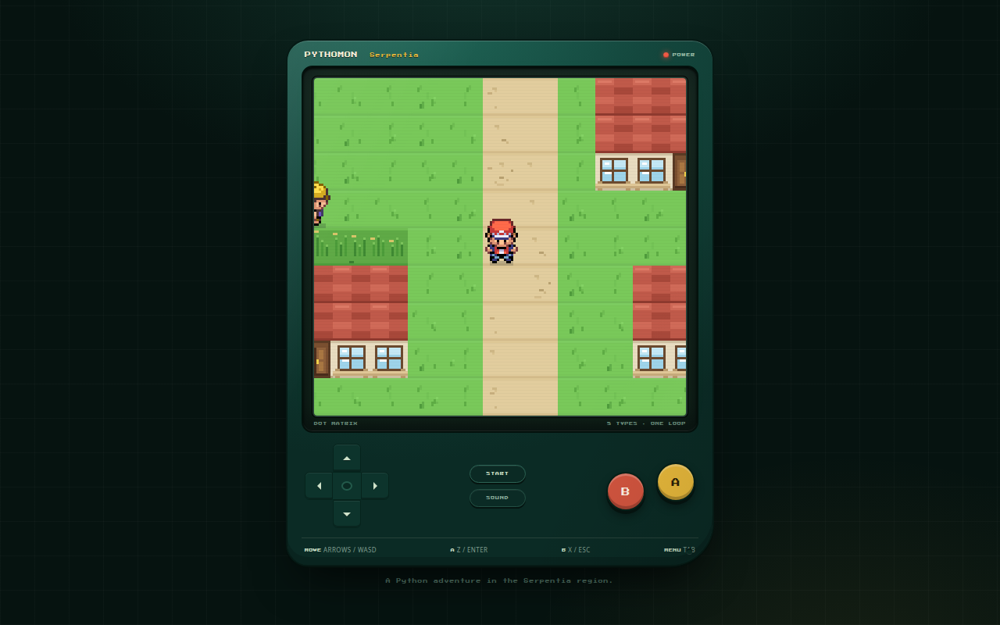

# Pythomon

Pythomon is a browser game that teaches Python. You catch and battle
creatures, and each battle is a small Python challenge. Answer the
challenge to act, and watch real Python code run to verify it.

The game runs in the browser. Python runs in a Web Worker through
[Pyodide](https://pyodide.org/), so no server is needed.



## Tech

- [Vite](https://vitejs.dev/) for the dev server and the build
- Vanilla JavaScript ES modules
- Pyodide in a Web Worker for Python
- [Vitest](https://vitest.dev/) for unit tests
- [Playwright](https://playwright.dev/) for end-to-end tests

## Run it

```sh
npm ci
npm run dev
```

Then open the printed local URL.

Other commands:

```sh
npm run build      # production build in dist/
npm test           # unit tests
npm run test:e2e   # end-to-end tests
```

## Play now

When this repo has GitHub Pages enabled, the game is playable at
https://abderrahim-lectures.github.io/pythomon/

## Deploy to GitHub Pages

The build sets its base path from `VITE_BASE`. GitHub Pages serves the
site at `/pythomon/`, so the workflow builds with
`VITE_BASE=/pythomon/`. For local testing of the Pages layout:

```sh
VITE_BASE=/pythomon/ npm run build
```

## The AI challenger

Battles can use an AI that writes Python answers, or the built-in static
bank of answers.

- The static bank works everywhere, including GitHub Pages.
- The live AI calls `https://opencode.ai/inference/openai/v1/`
  directly from the browser. That endpoint blocks cross-origin calls,
  so the live AI only works behind a local dev proxy or your own
  CORS proxy.

The dev server already proxies `/api/opencode` to that endpoint, so the
live AI works with `npm run dev`. On GitHub Pages the game falls back
to the static bank.

## Credits and licenses

The source code is MIT licensed. See `LICENSE`.

The game art is Pokémon fan art, used under non-commercial terms. See
`NOTICE.md` before reusing any sprite.

## Non-commercial use

This project is for learning. The sprites belong to their owners and
are used under non-commercial terms. Do not sell this game or its
assets.
